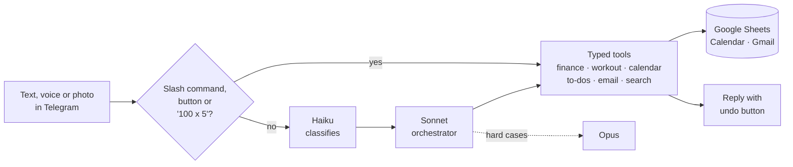

# EGO: Everything Gets Optimized

**One Telegram chat that runs my day.** Type or send a voice note and EGO logs the expense, books the meeting, coaches the lift and chases the to-do. No app switching, no forms.

Built solo as a serverless bot: Next.js, TypeScript, Claude (Haiku, Sonnet, Opus), Perplexity Sonar, Vercel AI SDK, on Vercel, with Google Sheets, Calendar and Gmail as the backend. **97% routing accuracy** (38/39) on my own 39-message eval set, re-run 2026-11-03 ([benchmarks](docs/benchmarks.md)).



> *"log lunch $14 and move my 3pm to 4"* → two tool calls, one message, both undoable.

## What it does

| | |
| --- | --- |
| 💸 **Finance** | Apple Pay taps and DBS PayLah!/Grab emails auto-log and auto-categorise. 15+ currencies, bill splitting with an IOU ledger, budgets with pacing alerts, CSV export. |
| 🏋️ **Workout coach** | Reads today's session from a 90-day powerlifting programme, walks me through it set by set, and starts a rest timer after every set. Log with `100 x 5`, or swap, add and drop exercises in plain language, for today or for good. |
| 📅 **Calendar** | Routes events to personal or work, finds free slots, reschedules in plain language, turns a schedule screenshot into up to 30 events (optionally tagged, e.g. *"tag it as HACK 2026"*) and retries through Google's rate limits. |
| ⏰ **To-dos & briefs** | *"remind me to call John"* nags every 30 minutes until done. Morning agenda, evening recap, weekly spending report. |
| 📬 **Email, memory, search** | Inbox triage and voice-drafted replies, encrypted notes, cited web answers. |

## Design choices

- **Fast where it can be.** Slash commands, buttons, cron jobs and plain `weight x reps` logging skip the model entirely.
- **Safe by design.** Single-user allowlist, verified webhooks, Zod-validated tool inputs, confirmation tokens for destructive actions, soft deletes and an undo button on every change.
- **Cost-aware.** Haiku classifies, Sonnet orchestrates, Opus is the last resort. `/credits` warns at 10% and 5% balance.
- **Stateless.** State lives in Google Sheets, so it runs happily on cold-start serverless functions.

## Avatar app (/ego)

`/ego` is a web app that talks to the same assistant as Telegram: same tools, same
sheets, same buttons (undo, edit), shown as an animated avatar. You can type or
hold a button to talk, and replies can be spoken aloud with lip sync. It installs
as a home-screen app on phone and desktop and can push proactive messages (briefings,
nags, alerts).

Setup:

1. Set `EGO_APP_TOKEN` (the sign-in token, at least 32 random characters) and
   `EGO_APP_SECRET` (signs the session cookie) in `.env.local` and Vercel.
   Spoken replies and voice input reuse `GOOGLE_GENERATIVE_AI_API_KEY`.
2. For push, generate a VAPID key pair with `npx web-push generate-vapid-keys`.
   Put the keys in `VAPID_PUBLIC_KEY` and `VAPID_PRIVATE_KEY`, and set
   `VAPID_SUBJECT` to a contact such as `mailto:owner@example.com`.
   If the VAPID variables are missing, push is a silent no-op: the app and
   Telegram keep working, nothing is sent and nothing errors.
3. Redeploy, open `https://<your-deployment>/ego`, and sign in with the token.

Install:

- **iPhone or iPad (Safari):** open `/ego`, sign in, tap Share, then Add to Home
  Screen, and open it from the new icon.
- **Android (Chrome):** open `/ego`, sign in, then menu, Install app (or Add to Home
  screen).
- **Desktop (Chrome or Edge):** open `/ego`, sign in, then click the install icon in
  the address bar.

Push notifications: turn them on with the notifications toggle in the app. On iOS
push only works from the installed home-screen app, not from a Safari tab; the app
shows a hint when it is not installed.

Using it:

- **Hold to talk:** press and hold the mic button, speak, release to send. The
  browser asks for microphone permission the first time.
- **Spoken replies:** replies are read aloud in short chunks so the first sound
  starts early. The "Voice replies" toggle turns this on or off and is remembered
  per device.
- **Interrupt:** tap the avatar while it is speaking to stop it.

## Run your own

1. `npm install`, copy the variables below into `.env.local` and Vercel.
2. Deploy to Vercel and point the Telegram webhook at `/api/telegram`.
3. Schedule the crons (Vercel Cron or [cron-job.org](https://cron-job.org)), each called with `Authorization: Bearer <CRON_SECRET>`.

<details>
<summary>Environment variables</summary>

| Group | Variables |
| --- | --- |
| Telegram | `TELEGRAM_BOT_TOKEN`, `TELEGRAM_WEBHOOK_SECRET`, `TELEGRAM_ALLOWED_USER_ID` |
| Google | `GOOGLE_SERVICE_ACCOUNT_EMAIL`, `GOOGLE_PRIVATE_KEY`, `GOOGLE_SHEET_ID`, `GOOGLE_WORKOUT_SHEET_ID`, `GOOGLE_CALENDAR_ID_PERSONAL`, `GOOGLE_CALENDAR_ID_WORK`, `GOOGLE_CLIENT_ID`, `GOOGLE_CLIENT_SECRET`, `GOOGLE_REFRESH_TOKEN` |
| AI | `ANTHROPIC_API_KEY`, `PERPLEXITY_API_KEY`, `GOOGLE_GENERATIVE_AI_API_KEY` (voice only) |
| Other | `CRON_SECRET`, `APPLE_WALLET_SECRET`, `GMAIL_PUBSUB_TOPIC` |
| Avatar app | `EGO_APP_TOKEN` (at least 32 characters), `EGO_APP_SECRET`, `VAPID_PUBLIC_KEY`, `VAPID_PRIVATE_KEY`, `VAPID_SUBJECT` (for example `mailto:owner@example.com`) |
| Optional | `MEMORY_ENCRYPTION_KEY`, `MONTHLY_BUDGET`, `EGO_EVAL_MODEL` (eval script only) |

Setup guides: [Apple Wallet](APPLE_WALLET_SETUP.md), [Gmail push](GMAIL_PUSH_SETUP.md).
</details>

<details>
<summary>Cron schedule (UTC)</summary>

| Endpoint | Schedule | Purpose |
| --- | --- | --- |
| `/api/cron/briefing?type=morning` | `0 0 * * *` | Morning brief |
| `/api/cron/briefing?type=evening` | `0 14 * * *` | Evening recap |
| `/api/cron/calendar-reminders` | `*/10 * * * *` | To-do nags, event pings, leave-now alerts |
| `/api/cron/rest-timer` | `* * * * *` | Workout rest-over pings |
| `/api/cron/recurring` | `0 1 * * *` | Recurring subscriptions and tasks |
| `/api/cron/cleanup` | `0 16 * * *` | Prune expired actions and logs |
</details>

<details>
<summary>Commands and tests</summary>

`/menu` `/split` `/owed` `/budget` `/finance` `/export` `/sync` `/freeslots` `/agenda` `/todo` `/remind` `/inbox` `/remember` `/recall` `/workout` `/workoutday` `/rest` `/credits`. Everything also works as plain language.

```bash
npm run test:ego        # orchestrator
npm run eval:ego        # routing accuracy vs live model (-- --dry-run for offline)
npm run bench:all       # latency, cost per call, parallel sync; results in docs/benchmarks.md
npm run test:workout-session && npm run test:split && npm run test:calendar && npm run test:calendar-batch && npm run test:memory
```
</details>

## AI assistance

I built this with AI coding assistants, including Claude Code. The instructions they work from are in `CLAUDE.md` and `AGENTS.md`, and the tests are how I check their work.

## License

The code is [MIT](LICENSE).
