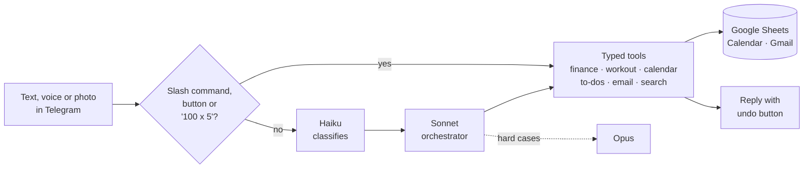

# EGO: Everything Gets Optimized

**One Telegram chat that runs my day.** Type or send a voice note and EGO logs the expense, books the meeting, coaches the lift and chases the to-do. No app switching, no forms.

Built solo as a serverless bot: Next.js, TypeScript, Claude (Haiku, Sonnet, Opus), Perplexity Sonar, Vercel AI SDK, on Vercel, with Google Sheets, Calendar and Gmail as the backend. **97% routing accuracy** (38/39) on a live eval set.



> *"log lunch $14 and move my 3pm to 4"* → two tool calls, one message, both undoable.

## What it does

| | |
| --- | --- |
| 💸 **Finance** | Apple Pay taps and DBS PayLah!/Grab emails auto-log and auto-categorise. 15+ currencies, bill splitting with an IOU ledger, budgets with pacing alerts, CSV export. |
| 🏋️ **Workout coach** | Reads today's session from a 90-day powerlifting programme, walks me through it set by set, and starts a rest timer after every set. Log with `100 x 5`, or swap, add and drop exercises in plain language, for today or for good. |
| 📅 **Calendar** | Routes events to personal or work, finds free slots, reschedules in plain language, turns a schedule screenshot into up to 30 events (optionally tagged, e.g. *"tag it as HACK 2026"*) and retries through Google's rate limits. |
| ⏰ **To-dos & briefs** | *"remind me to call John"* nags every 30 minutes until done. Morning agenda, evening recap, weekly spending report. |
| 📬 **Email, memory, search** | Inbox triage and voice-drafted replies, encrypted notes, cited web answers. |

## Design choices

- **Fast where it can be.** Slash commands, buttons, cron jobs and plain `weight x reps` logging skip the model entirely.
- **Safe by design.** Single-user allowlist, verified webhooks, Zod-validated tool inputs, confirmation tokens for destructive actions, soft deletes and an undo button on every change.
- **Cost-aware.** Haiku classifies, Sonnet orchestrates, Opus is the last resort. `/credits` warns at 10% and 5% balance.
- **Stateless.** State lives in Google Sheets, so it runs happily on cold-start serverless functions.

## Run your own

1. `npm install`, copy the variables below into `.env.local` and Vercel.
2. Deploy to Vercel and point the Telegram webhook at `/api/telegram`.
3. Schedule the crons (Vercel Cron or [cron-job.org](https://cron-job.org)), each called with `Authorization: Bearer <CRON_SECRET>`.

<details>
<summary>Environment variables</summary>

| Group | Variables |
| --- | --- |
| Telegram | `TELEGRAM_BOT_TOKEN`, `TELEGRAM_WEBHOOK_SECRET`, `TELEGRAM_ALLOWED_USER_ID` |
| Google | `GOOGLE_SERVICE_ACCOUNT_EMAIL`, `GOOGLE_PRIVATE_KEY`, `GOOGLE_SHEET_ID`, `GOOGLE_WORKOUT_SHEET_ID`, `GOOGLE_CALENDAR_ID_PERSONAL`, `GOOGLE_CALENDAR_ID_WORK`, `GOOGLE_CLIENT_ID`, `GOOGLE_CLIENT_SECRET`, `GOOGLE_REFRESH_TOKEN` |
| AI | `ANTHROPIC_API_KEY`, `PERPLEXITY_API_KEY`, `GOOGLE_GENERATIVE_AI_API_KEY` (voice only) |
| Other | `CRON_SECRET`, `APPLE_WALLET_SECRET`, `GMAIL_PUBSUB_TOPIC` |
| Optional | `MEMORY_ENCRYPTION_KEY`, `MONTHLY_BUDGET` |

Setup guides: [Apple Wallet](APPLE_WALLET_SETUP.md), [Gmail push](GMAIL_PUSH_SETUP.md).
</details>

<details>
<summary>Cron schedule (UTC)</summary>

| Endpoint | Schedule | Purpose |
| --- | --- | --- |
| `/api/cron/briefing?type=morning` | `0 0 * * *` | Morning brief |
| `/api/cron/briefing?type=evening` | `0 14 * * *` | Evening recap |
| `/api/cron/calendar-reminders` | `*/10 * * * *` | To-do nags, event pings, leave-now alerts |
| `/api/cron/rest-timer` | `* * * * *` | Workout rest-over pings |
| `/api/cron/recurring` | `0 1 * * *` | Recurring subscriptions and tasks |
| `/api/cron/cleanup` | `0 16 * * *` | Prune expired actions and logs |
</details>

<details>
<summary>Commands and tests</summary>

`/menu` `/split` `/owed` `/budget` `/finance` `/export` `/sync` `/freeslots` `/agenda` `/todo` `/remind` `/inbox` `/remember` `/recall` `/workout` `/workoutday` `/rest` `/credits`. Everything also works as plain language.

```bash
npm run test:ego        # orchestrator
npm run eval:ego        # routing accuracy vs live model (-- --dry-run for offline)
npm run test:workout-session && npm run test:split && npm run test:calendar && npm run test:calendar-batch && npm run test:memory
```
</details>
